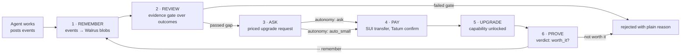
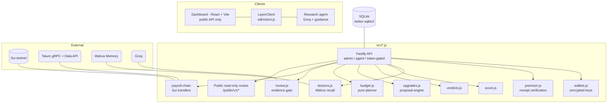

# EvoLoop

**The payroll and growth layer for AI agents.**
Give any AI agent a wallet, a budget and a memory. It earns a salary on Sui, asks for upgrades *with evidence*, and proves they worked — every claim backed by an on-chain receipt or a Walrus blob id.

> Agents don't get blank cheques. They get an allowance, a review, and an evidence gate. Upgrades that fail to prove themselves get rejected — and remembered.

```
work → remember → review → ask → pay → upgrade → prove → (remember again)
```

|          |                                                          |
| -------- | -------------------------------------------------------- |
| Payments | Real SUI transfers, confirmed via **Tatum's** Sui gRPC gateway |
| Memory   | Every verdict and lesson stored as a **Walrus** blob, decisions cite blob ids |
| Ledger   | **Sui testnet** wallets, salaries, vendor spends, explorer links |
| Reviews  | Groq-assisted gap descriptions inside a **deterministic evidence gate** |
| Demo UI  | Public read-only API + dashboard (`dashboard/`), demos run read-only by default |

---

## Table of contents

1. [Quickstart](#quickstart)
2. [The loop](#the-loop)
3. [Architecture](#architecture)
4. [Dashboard](#dashboard)
5. [Public read-only API and demo manager](#public-read-only-api-and-demo-manager)
6. [API reference (private)](#api-reference-private)
7. [Review engine and evidence gate](#review-engine-and-evidence-gate)
8. [Upgrades, budget and autonomy](#upgrades-budget-and-autonomy)
9. [Premium data service (receipt-gated)](#premium-data-service-receipt-gated)
10. [Upgrade verdicts](#upgrade-verdicts)
11. [Performance scores and salary suggestions](#performance-scores-and-salary-suggestions)
12. [Lessons: Walrus-driven memory](#lessons-walrus-driven-memory)
13. [SDK client (`sdk/client.js`)](#sdk-client-sdkclientjs)
14. [Research agent (`agents/research-agent/`)](#research-agent-agentsresearch-agent)
15. [Automated grader](#automated-grader-agentsresearch-agent)
16. [Demo cycle and portable-memory proof](#demo-cycle-and-portable-memory-proof)
17. [Environment reference](#environment-reference)
18. [Smoke tests and scripts](#smoke-tests-and-scripts)
19. [Accounts, sessions, workspaces and ownership (Phase B1)](#accounts-sessions-workspaces-and-ownership-phase-b1)
20. [Security notes](#security-notes)

---

## Quickstart

**Requirements:** Node.js **20+**. No package installs beyond `npm install`.

```bash
git clone https://github.com/gowthamchoudhary/EvoLoop
cd EvoLoop
npm install
```

1. **Configure `.env`** with your Walrus and Tatum credentials plus `ADMIN_TOKEN` (required). `WALLET_ENC_KEY` (random 32-byte hex) is generated and written to `.env` automatically if missing — it encrypts persisted wallet signing keys. Keep `.env` private.
2. **Create and fund the treasury**

   ```bash
   npm run treasury:create   # prints the treasury's public address — fund it from the Sui testnet faucet
   npm run vendors:seed      # creates the `premium-data-source` and `vision-api` recipient wallets
   npm run catalog:seed      # idempotent: maps vendor wallets into the upgrade catalog (src/review-config.js)
   ```

3. **Run it**

   ```bash
   npm run dev               # API on http://127.0.0.1:8787
   ```

4. **Optional: dashboard**

   ```bash
   npm run dashboard:install
   npm run dashboard:build   # built app is served from the same server (dashboard/dist)
   ```

Open `http://127.0.0.1:8787/` — the landing page and the `/app` demo workspace read the public API. End-to-end check: `npm run demo:cycle` (needs `GROQ_API_KEY`, treasury ≥ 0.2 SUI, catalog seeded). See [Smoke tests](#smoke-tests-and-scripts).

### Environment reference

Variable (defaults)                                              | Purpose
---------------------------------------------------------------- | ------------------------------------------------------------
`ADMIN_TOKEN` (required)                                         | Admin bearer token for private routes; never sent to browsers
`WALLET_ENC_KEY` (auto-generated)                                | 32-byte hex key used to encrypt persisted wallet signing keys
`NAMESPACE_PREFIX` (`pl-dev`)                                    | Walrus namespace prefix for per-agent memory
`PORT` (`8787`)                                                  | HTTP port
`DB_PATH` (`./data/payroll.db`)                                  | SQLite database path
`SUI_NETWORK` (`testnet`)                                        | `testnet` / `mainnet` — drives explorer links and safety guards
`TATUM_GRPC_HOST` (per selected network)                         | Tatum Sui gRPC endpoint override
`GAS_RESERVE_SUI` (`0.02`)                                       | Gas held back on every transfer
`GROQ_API_KEY`, `GROQ_MODEL` (`llama-3.3-70b-versatile`)         | Optional: gap descriptions. Without a key, descriptions fall back to templates
`PREMIUM_PASS_CALLS` (`20`), `PREMIUM_PASS_TTL_MINUTES` (`1440`), `PREMIUM_VERIFY_POLL_MS` (`40000`) | Premium pass size, lifetime, and the longest a claim waits for Tatum to index a transaction
`DEMO_ACTIONS_ENABLED` (`false`), `DEMO_MAX_APPROVALS_PER_HOUR` (`6`), `DEMO_MAX_APPROVALS_PER_IP_PER_HOUR` (`2`) | Demo approve/reject in the dashboard, off by default
`PUBLIC_RATE_LIMIT_PER_MIN` (`60` per IP), `PUBLIC_BALANCE_CACHE_SECONDS` (`20`) | Public API safety
`APP_ORIGIN` (`http://127.0.0.1:8787`)                  | Allowed `Origin` for browser auth/session calls (CSRF guard); `http://localhost:5173` is also allowed in development
`SESSION_TTL_DAYS` (`30`, clamped `1..180`)              | Browser session lifetime; guests always get a 12-hour session

---

## The loop



Every arrow above is code, not a slide. The memory write persists blob ids, the gate is pure `src/review.js` logic, the payment is a real Sui transaction, and the verdict feeds the next review. Nothing moves money without passing the gate.

---

## Architecture



| Module                | Role |
| --------------------- | ---- |
| `src/server.js`       | Fastify app, auth (`ADMIN_TOKEN` / agent keys), static serving of `dashboard/dist` |
| `src/payroll-chain.js`| Salary and vendor transfers on Sui, confirmed through Tatum |
| `src/review.js`       | Review + evidence gate, always deterministic before any model call |
| `src/budget.js`       | Pure budget planner (allowance, reserve, period windows) |
| `src/upgrades.js`     | Deterministic proposal planning with cooldowns and reserving |
| `src/verdicts.js`     | One-shot verdict per executed upgrade from stored numbers |
| `src/score.js`        | Performance scores and raise/probation suggestions |
| `src/lessons.js`      | Walrus recall → parsed lessons table |
| `src/premium.js`      | Receipt-gated paywalled data (402 until a payment verifies) |
| `src/walrus.js` / `src/memory-queue.js` | Memory writes + queue |
| `src/wallets.js`      | Encrypted wallet key storage |
| `src/public-routes.js`| Public read-only JSON (below `/public/v1`) |

SQLite (`better-sqlite3`) is the operating database; Walrus is the *portable* memory — see [the portable-memory proof](#demo-cycle-and-portable-memory-proof).

---

## Dashboard

`dashboard/` is a React 18 + Vite + HashRouter app served statically by the same server — one process, one port.

- **Public paths:** `/` (landing), `/how-it-works` (scroll-driven isometric scene), plus the workspace routes `/app/{overview,requests,agents,payroll,memory,activity}` and `/agent/:id` with tabs: Timeline, Score, Reviews & gaps, Requests, Verdicts, Payroll, Memory.
- **Data source:** only the public API (`/public/v1/*`). Polling ≤ 20 s, paused on hidden tabs. Route chunks (including the chart-heavy agent page) are lazy-loaded.
- **Acts:** demo Approve/Reject is guarded server-side by `DEMO_ACTIONS_ENABLED` + `SUI_NETWORK=testnet` + `demo_actionable` + pending status + hourly per-IP caps, and **only applies to agents explicitly flagged `demo_actionable`** by the admin. Demo decisions never execute a transfer; the drawer says "Decided by the agent's manager" otherwise.
- **No secrets in the browser:** `ADMIN_TOKEN` and agent keys never appear in dashboard code; a public smoke test scans public responses for secret shapes (`plk_`, `suiprivkey`, `enc_key`, `api_key`).

Build: `npm run dashboard:build` → static output in `dashboard/dist`, served by the Node server.

---

## Public read-only API and demo manager

Agents are private by default. An admin publishes/unpublishes with:

```
PUT /v1/agents/:id/visibility    body { "public": true, "demo_actionable": false }
```

Public JSON is available **without a token** under `/public/v1`:

| Route | Returns |
| ----- | ------- |
| `GET /public/v1/system` | Network, Walrus counters, Tatum activity totals, demo flags |
| `GET /public/v1/agents` | Published agents (settings, balance, latest score, pending request count) |
| `GET /public/v1/agents/:id/{timeline,reviews,requests,verdicts,scores,suggestions,transactions,lessons}` | Per-agent reads |
| `GET /public/v1/tatum/activity` | Limited transport activity summary |

Notes:

- Only published agents are visible. Public lessons use stored database rows and never trigger a live Walrus recall. Public SUI balances are live Tatum gRPC reads with a short cache (`PUBLIC_BALANCE_CACHE_SECONDS`).
- `npm run demo:publish` publishes the newest `research-agent*` with an executed upgrade request and a verdict, demo actions off. Add `-- --actionable` to flag it actionable.
- IP identifiers in demo action logs are stored only as salted hashes, and `npm run smoke:public` scans every published response for configured secret values and the markers `api_key`, `enc_key`, `plk_`, `suiprivkey`.

---

## API reference (private)

All responses are JSON. **Admin** routes use `Authorization: Bearer ADMIN_TOKEN`; **agent** routes use the one-time agent API key returned at registration.

### Agents, wallets, payroll

| Method & route | Auth | Purpose |
| -------------- | ---- | ------- |
| `GET /health` | none | Server and database health |
| `POST /v1/agents/register` | admin | Body `{ "name", "kind", "description" }` |
| `POST /v1/agents/:id/wallet` | admin | Create or return the agent's public wallet address |
| `PUT /v1/agents/:id/policy` | admin | `salary_sui`, `per_tx_cap_sui`, `period_cap_sui`, `allowed_vendor_ids` |
| `POST /v1/payroll/run` | admin | `{ "period_label", "agent_id?" }` — pays eligible agents on Sui |
| `POST /v1/spend` | agent | Vendor spend subject to policy checks |
| `GET /v1/agents/:id/balance` | agent-or-admin | Live Tatum gRPC balance |
| `GET /v1/transactions/:digest/verify` | agent-or-admin | Transaction status from Tatum |
| `GET /v1/agents`, `GET /v1/memories?status=` | admin | Summaries and memory queue records |
| `GET /v1/tatum/activity` | admin | Recent Tatum RPC activity and retry counts |
| `GET /v1/agents/:id/transactions`, `/payslips` | agent-or-admin | Ledger + payslips |

### Events and settings

`POST /v1/events` accepts an optional `session_id` (max 64 chars); when omitted it defaults to the UTC date (`YYYY-MM-DD`) of `ts`. Events may carry `details.gap_hint` — one of `perception`, `knowledge`, `tools`, `reasoning`, `speed_cost`, `personalization`, `reliability`.

| Method & route | Auth | Purpose |
| -------------- | ---- | ------- |
| `GET /v1/agents/:id/events?limit=&type=` | agent-or-admin | Event history |
| `PUT /v1/agents/:id/settings` | admin | Upsert `period` (`daily\|weekly\|monthly\|compressed`), `period_minutes`, `allowance_mist`, `improvement_reserve_pct` (0–100), `autonomy` (`ask\|auto_small\|never`), `auto_limit_mist`, `rollover`. Defaults: `monthly`, 40%, `ask`, zero allowances, no rollover |
| `GET /v1/agents/:id/settings` | admin | Stored settings or defaults |

### Reviews, proposals, requests

| Method & route | Auth | Purpose |
| -------------- | ---- | ------- |
| `POST /v1/agents/:id/review/run` | admin | Optional `period_label`, `window_start`, `window_end`; returns the review + gaps |
| `GET /v1/agents/:id/reviews`, `GET /v1/reviews/:id` | admin | Review history (gap counts) / one review with gaps |
| `POST /v1/gaps/:id/dismiss` | admin | Marks the gap `dismissed`, queues `gap_dismissed` memory |
| `GET /v1/catalog` | admin | Active/inactive catalog items (vendors, capabilities, taxonomies, fix types, prices) |
| `POST /v1/reviews/:id/proposals` | admin | Plans purchases for `passed_gate` gaps of `medium`/`high` priority; returns created requests + skipped gaps with reasons |
| `GET /v1/requests?agent_id=&status=`, `GET /v1/requests/:id` | admin | Requests with parsed budget, baseline and linked gap |
| `POST /v1/requests/:id/approve` | admin | `{ "note?", "extra_budget_sui?" }`. Approval of a `needs_raise` request raises the allowance by `extra_budget_sui` (default: recorded shortfall), then executes. A decided request returns **409** and never pays twice |
| `POST /v1/requests/:id/reject` | admin | `{ "note?" }`; queues the rejection memory |
| `POST /v1/requests/:id/verdict/evaluate` | admin | Compares the stored baseline with post-unlock outcomes; stores `worth_it` / `not_worth_it` / `inconclusive`. Re-calls return the same verdict — **no endpoint edits a verdict** |
| `GET /v1/agents/:id/verdicts` | admin | Verdict history, newest first |
| `POST /v1/agents/:id/propose-check?capability_key=…` | admin | Dry-run of proposal creation `{ would_propose, reasons[], decision_basis[] }` — creates nothing |

### Agents, guidance, memory

| Method & route | Auth | Purpose |
| -------------- | ---- | ------- |
| `GET /v1/agents/:id/guidance` | agent-or-admin | Unlocked capabilities, current budget window + numbers, on-chain balance, pending request count, premium pass status, up to 5 recalled lessons |
| `GET /v1/agents/:id/recall?q=&limit=5` | agent-or-admin | Search the agent's Walrus namespace |
| `GET /v1/agents/:id/lessons?refresh=1` | agent-or-admin | Parsed lessons, each with its `blob_id`; `refresh=1` forces a Walrus recall first |
| `POST /v1/agents/:id/lessons/restore` | admin | Force-recall and rebuild lesson rows from Walrus only |
| `POST /v1/agents/import` | admin | Creates an agent record with **exactly** the given id (so a Walrus namespace `prefix:agent_id` matches an existing one); second import → 409 |
| `PUT /v1/agents/:id/suggestions/:id/accept\|dismiss` | admin | Apply or discard a raise/probation suggestion |

### Premium data

| Method & route | Auth | Purpose |
| -------------- | ---- | ------- |
| `POST /v1/premium/claim` | agent | `{ "digest", "poll_timeout_ms?" }` — verifies the payment on chain, creates the pass: `{ calls_granted, calls_remaining, expires_at, receipt }` |
| `GET /v1/premium/data?type=price&symbol=SUI&currency=INR`<br>`GET /v1/premium/data?type=balance&address=0x…` | agent | Paywalled data; without an active pass → **402** `{ "error": "payment_required", "pay_to", "amount_sui", "network", "asset", "how" }` |
| `GET /v1/agents/:id/premium` | agent-or-admin | Pass status (`active`, calls granted/used/remaining, expiry, price) |

---

## Review engine and evidence gate

Thresholds in `src/review-config.js`:

| Tunable | Value | Meaning |
| ------- | ----- | ------- |
| `MIN_OUTCOMES` | **5** | Minimum outcomes for a category to enter the gate |
| `MIN_ISSUE_RATE` | **0.30** | Minimum issue rate to make it a gap |
| `MIN_SESSIONS_WITH_ISSUES` | **2** | Problem must repeat across sessions |
| `IMPACT_SATURATION` | **10** | Issues at which impact = 1 |
| `HIGH_PRIORITY` / `MEDIUM_PRIORITY` | **0.35 / 0.15** | Priority label thresholds |

The review window is `window_start`/`window_end`; without them it runs from the end of the previous review (or agent creation) to now. Outcomes: `task_completed`, `task_failed`, `user_corrected`, `task_abandoned` — the last three are issues. Metrics are computed **only** in `src/review.js`: outcome/issue counts, issue rate, issues by type, distinct sessions with issues, capability-missing count, total `cost_usd`, grouped by `task_category`.

A category passes the gate **only when all of these hold**, and every failed condition is stored in `gate_reasons`:

1. at least 5 outcomes;
2. issue rate ≥ 0.30;
3. ≥ 2 distinct sessions with issues;
4. every cited evidence event id exists in the database;
5. the `(task_category, taxonomy)` pair is not dismissed by the user.

Failing categories are stored as `rejected_gate` (or `dismissed` when user-dismissed) with template descriptions — they are **never sent to the model**. A gap's *taxonomy* is the most frequent mapped cause across its issue and capability-missing events (`details.gap_hint` wins when known, `capability_missing → tools`, anything else → `reliability`). Evidence is up to 20 of the most recent issue and capability-missing events per category.

Derived values: `severity = issue rate`, `impact = min(1, issues / 10)`, `priority = severity × impact` (3 decimals), labels `high ≥ 0.35`, `medium ≥ 0.15`, else `low`. Review outcome: `insufficient_data` when nothing reaches 5 outcomes, `no_gaps` when categories have data but none pass, else `gaps_found`.

Passed gaps get **one Groq chat completion** containing only computed metrics + event summaries. Valid reply shape: `fix_type` ∈ `model | data_source | tool | workflow | memory_strategy | none`, description ≤ 300 chars, no event ids outside the evidence set — anything else falls back to a template (`description_source = "template"`). Every review queues one Walrus memory (`Agent <id> | review | <period_label> | outcome: <outcome> | <summary>`), including `no_gaps` reviews, with `review_id` set and `event_id` NULL. **The review engine never sends transfers or touches wallets.**

---

## Upgrades, budget and autonomy

Tables: `upgrade_catalog`, `upgrade_requests`, `agent_capabilities`; treasury top-ups live in `transactions` with `kind = 'topup'` beside `salary` and `spend`. Prices are integer MIST strings. Tunables in `src/review-config.js`: `UPGRADE_CATALOG`, `REJECT_COOLDOWN_DAYS=7`, `PROPOSAL_COOLDOWN_MINUTES=30`, `UPGRADE_TOPUP_GAS_MARGIN_MIST`. `npm run catalog:seed` resolves each catalog item's vendor by label and is safe to re-run.

Proposals are planned by **deterministic code** (`src/upgrades.js`), not a model:

- only gaps from that review with `status='passed_gate'` and `medium`/`high` priority, in `task_category` order then priority;
- catalog item chosen by taxonomy, preferring the gap's stored `fix_type`; no match → a zero-cost `note_only` request that records the gap;
- skipped when the same `(agent, capability_key)` is already unlocked, has a request in `pending_approval`, `approved`, `auto_approved` or `needs_raise`, or was rejected within cooldown (`REJECT_COOLDOWN_DAYS`, or `PROPOSAL_COOLDOWN_MINUTES` for compressed-period agents) — unless the new gap's priority is strictly higher;
- `expected_benefit`, `baseline_json` and budget numbers come from the gap's stored metrics; each plan in one run **reserves its cost**, so two proposals in one review can't both spend the same allowance.

### The budget planner (`src/budget.js`) — pure

- `improvement_cap = allowance_mist × improvement_reserve_pct / 100`
- `improvement_spent` = executed upgrade costs in the window + costs reserved in this planning run
- `improvement_remaining = max(0, cap − spent)`; a purchase is within budget only when its **full cost** fits
- Also reports the agent's live balance (Tatum) and whether a treasury top-up would be needed for `cost + GAS_RESERVE`

### Autonomy (applied after budget)

| Autonomy | On a fundable gap |
| -------- | ----------------- |
| `never` | `note_only` |
| `ask` | `pending_approval` |
| `auto_small` | `auto_approved` + immediate execution **only when** cost ≤ `auto_limit_mist`, else `pending_approval` |
| anything, when the cost doesn't fit the allowance | `needs_raise` — explicit admin approval required, autonomy is never bypassed |

Approval and auto-approval run the same `executeRequest`: vendor added to `allowed_vendor_ids` → treasury top-up (kind `topup`, confirmed via Tatum) if needed → spend through the normal policy path (`Upgrade: <capability_key> for <task_category>`, category `upgrade`, producing the usual `cost_incurred` event and Walrus memory) → request `executed`, capability unlocked, memory queued. A blocked rule or failed transfer sets the request `failed` with the failing **stage** and stops before any further transfer. The status transition is atomic and execution is **serialized per agent** — concurrent approvals cannot both send money.

---

## Premium data service (receipt-gated)

One pass costs the `premium_data` catalog price (**0.015 SUI**), paid like any other spend to the `premium-data-source` vendor. The pass is a row in `payment_receipts` keyed by the payment digest: `PREMIUM_PASS_CALLS` calls (default 20) for `PREMIUM_PASS_TTL_MINUTES` minutes (default 1440).

`POST /v1/premium/claim` verifies the receipt in `src/premium.js` against Tatum's `LedgerService.GetTransaction`, polling `NOT_FOUND` for up to `PREMIUM_VERIFY_POLL_MS` (40 s), and reads `digest`, `transaction.sender`, `effects.status`, `balance_changes`. A claim succeeds only when **all** hold, and returns exactly one of these error codes otherwise:

1. digest exists on chain — else `receipt_not_found`;
2. transaction succeeded — else `tx_failed`;
3. sender is the agent's own wallet — else `wrong_sender`;
4. the `premium-data-source` address received SUI in `balance_changes` — else `wrong_recipient`;
5. amount ≥ catalog price — else `insufficient_amount`;
6. digest not already a receipt — `already_claimed` (same agent) / `claimed_by_other_agent` (replay protection, HTTP 409).

`GET /v1/premium/data` consumes one call **atomically** (`calls_used` increments only while `calls_used < calls_granted`, the row is active and unexpired, and it flips to `exhausted` on the last call). Responses:

| `type` | Source | Shape |
| ------ | ------ | ----- |
| `price` | Tatum v4 Data API rate endpoint (`GET /v4/data/rate/symbol`, `x-api-key`), routed through the shared run queue / retry policy / activity log as `rest:GET /v4/data/rate/symbol`, cached 20 s per pair | `{ type, symbol, currency, value, timestamp, source: "tatum-rates", calls_remaining }` |
| `balance` | Tatum gRPC `GetBalance` | `{ balance_sui, coin_objects_sui, address_balance_sui, source: "tatum-grpc", calls_remaining }` |

Every premium call is logged to `premium_calls` (agent, type, outcome). When an upgrade purchase of `premium_data` executes, the flow claims its own spend digest automatically; if verification fails the capability row is flagged `receipt_unverified` and nothing is reversed. Guidance carries the pass status alongside budget and capabilities.

---

## Upgrade verdicts

Every executed upgrade request is measured — once. `POST /v1/requests/:id/verdict/evaluate` stores **one** verdict in `upgrade_verdicts` from stored numbers only: the baseline is the request's `baseline_json` (the gap's issue rate at proposal time); the "after" side counts outcomes in the same `task_category` with `ts` after the capability's `unlocked_at` (`issue_rate = issues / outcomes`).

Tunables in `src/review-config.js`: `MIN_AFTER_OUTCOMES=5`, `WORTH_IT_DROP=0.20`, `NOT_WORTH_DROP=0.05`, `VERDICT_COOLDOWN_DAYS=30`, `VERDICT_COOLDOWN_MINUTES_COMPRESSED=120`.

| Condition | Verdict |
| --------- | ------- |
| `after_outcomes ≥ 5` and `baseline − after ≥ 0.20` | `worth_it` |
| `after_outcomes ≥ 5` and `baseline − after ≤ 0.05` | `not_worth_it` |
| otherwise (including < 5 after-outcomes) | `inconclusive` |

A `not_worth_it` verdict blocks re-proposing the same capability for the cooldown (30 days; 120 minutes for compressed-period agents), proposal pages skip them with a `verdict_cooldown` reason, and reviews append relevant verdict history to their summary.

## Performance scores and salary suggestions

`POST /v1/agents/:id/score/snapshot` records a score from real outcome events, executed spend/top-up transactions, allowance settings and verdicts — nothing else:

| Component | Weight | Formula |
| --------- | -----: | ------- |
| Quality | 0.6 | `1 − issue_rate` (failed, corrected, abandoned are issues) |
| Discipline | 0.2 | `1 − min(1, spent / allowance)` |
| Upgrades | 0.2 | share of conclusive verdicts marked `worth_it` |

Missing components are **excluded** and the remaining weights renormalized. Score = 100 × weighted total, 1 decimal. Fewer than 5 outcomes → `insufficient_data`, no suggestion.

Suggestions are decisions for a manager, **never applied automatically**: a raise is suggested only at score ≥ 80, at least 30 points above the previous scored snapshot, and with ≥ 1 `worth_it` verdict; probation after two consecutive scored snapshots below 50; anything else is a hold. Raise and probation adjust the allowance by 25%; hold leaves it unchanged. Accepting probation also sets autonomy to `ask` unless it is already `never`. Accept/dismiss happens only through the admin API.

---

## Lessons: Walrus-driven memory

Upgrade-decision memories all follow the structured shape `Agent <agent_id> | <kind> | ...` with kinds `upgrade_purchased`, `upgrade_rejected`, `upgrade_verdict`, `gap_dismissed` (legacy text `gap dismissed by user: <category>` still parsed) and `review` (`... | <period_label> | outcome: <x> | ...`). `src/lessons.js` (`parseMemoryText`) ignores foreign agent ids and unknown kinds.

`recallLessons(agentId, { force })` runs five recall queries against the agent's own Walrus namespace (limit 10 each), parses every hit and upserts into the `lessons` table — one row per `(agent_id, source_text)`, keeping the recalled `blob_id`. Cached per agent for 60 s unless forced; a recall failure or 20 s timeout resolves to `{ ok: false, error }` so callers fall back to the database instead of crashing. **Nothing is ever inserted into `lessons` by hand** — every row exists because a real blob was recalled.

Decisions consume lessons from **both** state sources (proposal planning and the review gate's dismissal check recall first, and skip when either says skip):

| Lesson state | Skip reason |
| ------------ | ----------- |
| `upgrade_verdict` `not_worth_it` inside verdict cooldown | `lesson_verdict_not_worth_it` |
| `upgrade_rejected` inside rejection cooldown | `lesson_rejected_cooldown` |
| `upgrade_purchased` for the capability | `lesson_capability_purchased` |
| `gap_dismissed` for the same task category | `lesson_gap_dismissed` — and the review gate records `dismissed_by_user` citing the lesson's blob id |

Every skipped entry and every created request records `decision_basis` in `budget_json` (also on proposal responses): the consulted evidence, each item `{ source: "walrus"|"database", kind, capability_key, blob_id?, text_excerpt (≤ 120 chars) }`. When recall failed, `decision_basis_note: "walrus_recall_failed_used_database"` says the database alone decided. The request-detail route exposes parsed `decision_basis`; the proposals response carries a `skipped_proposals` array with the same reason/basis payloads; guidance includes up to 5 lessons plus a `lessons_recall` status.

---

## SDK client (`sdk/client.js`)

`LayerClient` is dependency-free plain JS (fetch only) and imports nothing from `src/`.

```js
import { LayerClient } from "./sdk/client.js";

const client = new LayerClient({ baseUrl, apiKey, agentId });
await client.report({ ts, type: "task_completed", summary, session_id });
const g = await client.guidance();            // capabilities, budget, pending requests, pass, lessons
await client.premiumPrice("SUI", "USD");      // 200 + value, or 402 payment_required
await client.claimReceipt(digest);            // verify on-chain payment as a pass
```

All methods return `{ status, data }` — parsed JSON including error codes like `payment_required` — and reject only on network failure: `report(event)`, `guidance()`, `premiumPrice(symbol, currency)`, `premiumBalance(address)`, `claimReceipt(digest)`.

---

## Research agent (`agents/research-agent/`)

`answerQuestion(question, { client, groq, sessionId })`:

1. `guidance()` decides whether `premium_data` is unlocked **and** the pass has calls remaining.
2. A Groq chat call (temperature 0, model `GROQ_MODEL`) classifies the question with strict JSON validation: `needs_live_data`, and for live questions `{ kind: "price", symbol, currency }` or `{ kind: "balance", address }`. Invalid JSON → treated as static, never guessed.
3. **Live & capable:** the answer states only the value returned by the premium endpoint and its source; a 402 is treated as not having the capability.
4. **Live & not capable:** posts a `capability_missing` event (`needs live data: <kind>`, `gap_hint "knowledge"`, `task_category "finance_qa"`), then the model answers best-effort — knowingly imperfect, never faked.
5. **Static:** the model answers directly.

Returns `{ answer, usedPremium, needsLive }`.

## Automated grader (`agents/research-agent/`)

The grader posts a graded event for every answer with the agent's key; ground truth is fresh Tatum data fetched by the runner at grading time (admin side, never through the agent's pass):

| Answer type | Correct when |
| ----------- | ------------ |
| price | a parsed number is within **3%** of a fresh Tatum rate (`getRate`) |
| balance | a parsed number matches the live Tatum gRPC total within **0.0005 SUI** |
| static | every expected keyword appears (case-insensitive, word-boundary matched) |

Number parsing handles commas, currency symbols, strips `0x` addresses. Graded events carry `details.source = "automated_grader"`, the runner-provided `session_id` and `task_category`; correct → `task_completed` (score 1), incorrect → `user_corrected` (score 0) with correction text `expected about X, got Y`. The question bank (`questions.js`) has live `finance_qa` questions per phrasing/currency/address (3 price phrasings × USD/INR/EUR; 4 balance phrasings × treasury + both vendor addresses, read from the DB at run time) and at least 12 static `general_knowledge` facts with expected keywords.

---

## Demo cycle and portable-memory proof

### `npm run demo:cycle` — one full upgrade lifecycle, with real money

Preconditions are checked **before any transfer** and stop with clear messages: `GROQ_API_KEY` set (one real call), treasury ≥ 0.2 SUI, catalog seeded.

The cycle registers `research-agent-<random>`, creates its wallet, allows no vendors, sets compressed settings (30 min period, 0.05 SUI allowance, 40% reserve, `ask`), then pays that one agent (0.05 SUI, verified). It runs two 14-task periods (10 live `finance_qa` + 4 static `general_knowledge`) across 3 sessions each through the real agent and grader, printing a line per task. Between them: review 1 (must gate the `finance_qa` knowledge gap) → proposals (`premium_data` `pending_approval`) → admin approval (real 0.015 SUI spend through the normal upgrade path, capability unlocked, pass auto-claimed — needs `PREMIUM_PASS_CALLS ≥ 12`) → `verdict/evaluate` → review 2 whose proposals must **not** re-propose `premium_data`. It prints guidance, verdict history and the last 10 Tatum activity entries, states the final verdict with raw numbers even when `not_worth_it`, deactivates the agent in all cases, and prints the treasury balance before and after.

### `npm run demo:portable` — memory belongs to the agent, not the database

Sends no money:

1. Finds the most recent `research-agent*` with ≥ 1 stored `upgrade_purchased` and ≥ 1 `upgrade_verdict` memory, printing their blob ids (clear stop message when none — run `demo:cycle` first).
2. Deletes `./data/portable-demo.db`, seeds it with the real vendors and upgrade catalog, and starts a **second server process** on port 8788 with that empty database and the same namespace prefix and Walrus credentials.
3. On the second server, imports the SAME agent id (`POST /v1/agents/import`), confirms the fresh database has zero events / capabilities / lesson rows, then calls `lessons/restore`: every lesson row is rebuilt from Walrus recall only, keeping each `blob_id`.
4. Dry-runs `propose-check` for `premium_data` (must be `would_propose=false` with a `decision_basis` item whose source is `walrus` citing a blob id) and reports the `vision` check honestly (usually `true` without lessons for it).
5. Stops the second server, deletes its database file, prints PASS/FAIL with timings per step, exits non-zero on failure.

---

## Smoke tests and scripts

`npm run smoke:block1` is safe to run any time. After funding the treasury:

| Script | Checks |
| ------ | ------ |
| `npm run smoke:block2` | Live testnet payroll and spend checks |
| `npm run smoke:block3` | Settings and the review engine against a running server — registers its own `smoke-review-*` agent, posts events, reviews, dismisses a gap, deactivates the agent at the end. Never moves money; waits only for memories to be queued, not written |
| `npm run smoke:block3b` | Upgrade catalog, budget planner, approval, rejection, autonomy modes and guidance with **real testnet transfers** — needs ≥ 0.15 SUI in the treasury; pays only the `smoke-upgrade-*` agents it creates and deactivates them whether it passes or fails |
| `npm run smoke:block3c1` | Premium paywall end to end with real transfers — pays two `smoke-premium-*` agents 0.05 SUI each, one buys a pass, the pass drains; needs ≥ 0.12 SUI in treasury |
| `npm run smoke:public` | Public response safety scan (secret shapes, markers) |
| `npm run score:replay` | Scores from the existing event history |
| `scripts/verify-last-smoke.js` (`npm run verify:smoke`) | Verifies the last smoke run |
| `scripts/debug-transfer.js` / `debug-confirm.js` | Transfer debugging helpers |

---

## Accounts, sessions, workspaces and ownership (Phase B1)

### Auth model

- **Email + password** — `POST /v1/auth/register`, `POST /v1/auth/login`. Passwords: scrypt (`N=16384, r=8, p=1`, 64-byte key, 16-byte random salt) stored as `s2_<salt>$<hash>`, compared with `timingSafeEqual`, minimum length 10 with a small weak-password blocklist. Wrong credentials always return the generic `401 "invalid email or password"`.
- **Sui wallet sign-in** — `GET /v1/auth/wallet/nonce?purpose=login|link` issues a single-use nonce (48 hex chars, consumed on first use, 5-minute TTL); the server builds the message (`EvoLoop sign-in + nonce + configured network + issued-at`) and `POST /v1/auth/wallet` verifies the personal-message signature with `@mysten/sui/verify`'s `verifyPersonalMessageSignature`, asserting the recovered key derives exactly the claimed `0x…` address (64 hex after normalization). A wallet-first login creates the user **and** their personal workspace.
- **Guest sessions** — `POST /v1/auth/guest` creates a role-`guest` user with a 12-hour session, attached read-only (`viewer`) to `ws_default`. Guests can never create agents or move money.

### Sessions

- Cookie `evl_session`: `HttpOnly; SameSite=Lax; Path=/`, `Secure` whenever the request is HTTPS (`X-Forwarded-Proto`) or `NODE_ENV=production`, `Max-Age` from `SESSION_TTL_DAYS` (default 30 days; guests 12 h).
- The database stores only `sha256(raw token)` as the session id (`ip_hash` + `user_agent_hash` are stored hashed too); the raw token lives only in the cookie and is never returned in any JSON body.
- No `Authorization: Bearer` fallback for browser sessions.
- Expired sessions and stale nonces are pruned at boot and hourly.

### CSRF guard and rate limits

Every state-changing `/v1/auth/*` and `/v1/my/*` call requires the header `X-EvoLoop-Client: web` and — when an `Origin` header is present — an origin matching `APP_ORIGIN` (plus `http://localhost:5173` in development); otherwise `403 csrf_blocked`.

| Endpoint group | Limit |
| --- | --- |
| `POST /v1/auth/register` | 10/min per IP |
| `POST /v1/auth/login` | 15/min per IP **and** 8 failed attempts per email per 15 min → 429 for that email for 15 min |
| `GET /v1/auth/wallet/nonce` | 30/min per IP |
| `POST /v1/auth/wallet` | 20/min per IP |
| `POST /v1/auth/guest` | 20/min per IP |
| `GET /v1/auth/session`, `POST /v1/auth/logout` | 120/min per IP |
| `/v1/my/*` mutations | 60/min per IP |

### Workspaces and ownership

- Every user gets a **personal workspace** at registration (role `owner` in `workspace_members`). Existing agents live in the backfilled `ws_default` where demo agents and all `ADMIN_TOKEN` routes continue to operate exactly as before.
- `agents.workspace_id` (defaults to `ws_default`) resolves every record's workspace; the ownership API under `/v1/my` checks membership and answers **404 (not 403)** for records in other workspaces so their existence never leaks.
- **Role matrix:** `owner` = everything; `approver` = approve/reject requests; `viewer` (incl. guests) = read-only.
- **Per-workspace treasury:** `workspaces.treasury_wallet_ref` → `wallets(owner_type='treasury', owner_id=ref)`. `ws_default` keeps the legacy global treasury row; new workspaces create a fresh encrypted keypair lazily via `POST /v1/my/workspace/treasury` (never at signup). Payroll and upgrade top-ups resolve the treasury from the **agent's workspace** (`src/wallets.js` + `src/auth.js::treasuryWalletForAgent`), never from a global lookup.
- **Agent lifecycle pause:** `agents.status='paused'` blocks spend and payroll (paused agents are skipped, not paid) and `/v1/events` answers `423 agent_paused` for that agent's key. `archive` (status `archived`) retires the key entirely.

### `/v1/*` route list (Phase B1)

| Group | Method + path | Who | Notes |
| --- | --- | --- | --- |
| Account | `POST /v1/auth/register` · `/login` · `/logout` · `/guest`, `GET /v1/auth/session`, `GET /v1/auth/wallet/nonce`, `POST /v1/auth/wallet` | public (session where noted) | Session cookie in, user + workspace summary out; raw token never in a body |
| Workspace | `GET /v1/my/workspace` (workspace, role, treasury address + live balance) · `POST /v1/my/workspace/treasury` (owner) | session | |
| Agents | `GET/POST /v1/my/agents`, `GET /v1/my/agents/:id`, `PATCH /v1/my/agents/:id`, `PUT /v1/my/agents/:id/settings` · `/policy` (owner, same validation as admin routes), `POST /v1/my/agents/:id/pause` · `/resume` · `/rotate-key` · `/archive`, `GET /v1/my/agents/:id/{events,reviews,scores,transactions,verdicts,lessons,guidance}` | session + membership | Agent creation registers exactly like the admin route, creates the agent wallet, applies default policy/settings (0.05 SUI weekly allowance, 40% reserve, autonomy `ask`, 0.03 SUI per-tx cap) and returns the API key **once** |
| Requests | `GET /v1/my/requests`, `GET /v1/my/requests/:id`, `POST /v1/my/requests/:id/approve` · `/reject` (owner/approver; `decided_by: user:<id>`) | session | Viewer gets `403` |
| Payroll | `POST /v1/my/payroll/run {agent_ids?, period_label}` (owner; workspace agents only; workspace treasury; clear refusals when no treasury or insufficient balance) | session | |

### Custody statement

On **testnet**, the server holds the agent wallet signing keys — generated server-side and persisted **AES-256-GCM-encrypted** with `WALLET_ENC_KEY`. Salaries and upgrade payments are transfers from workspace treasuries and agent wallets by the server itself; no dashboard/browser code ever sees a private key.

### Verification (no transfers)

`npm run smoke:auth` exercises the full matrix against a live server + real SQLite: cookie flags (HttpOnly/`SameSite=Lax`; `Secure` added under `X-Forwarded-Proto: https`), no raw token in bodies vs `sessions.id = sha256(token)` in the DB, generic login errors, the 8-failure email lockout, 409 duplicate email, CSRF blocks, key-once agent creation, cross-workspace `404`s, pause → `423` → resume, key rotation, guest read-only rules, logout invalidation, and single-use wallet nonces. `npm run smoke:public` and `npm run smoke:block3` (no-transfer) confirm the pre-existing behavior is unchanged.

## Security notes

- `ADMIN_TOKEN` authorizes admin routes; agent keys are one-time secrets returned at registration. Neither appears in browser code.
- Browser sessions: cookie `HttpOnly; SameSite=Lax` (+ `Secure` on HTTPS), `sha256` at rest, CSRF double-guard (`X-EvoLoop-Client` + `Origin` allowlist), email lockout after 8 failed logins, and per-user rate limits (see the table above).
- Ownership API answers `404` for cross-workspace records — no existence oracle; guest and `viewer` roles cannot mutate anything.
- Wallet signing keys are persisted **encrypted** with `WALLET_ENC_KEY`.
- Execution is serialized per agent; a decided request returns 409 rather than paying twice.
- Demo actions default to **disabled off**, are testnet-only, rate-limited hourly (global and per salted-hash IP), and never execute transfers.
- Walrus namespace is per agent (`prefix:agent_id`); recall never reads another agent's namespace.
- `.env` stays private; the public smoke test scans published responses for secret shapes.

---

## Honest notes

- **Demo periods are compressed** — a "period" can be minutes instead of a month, so upgrades and verdicts finish in one run.
- The performance grader is automated feedback standing in for a user; it grades against real Tatum rates and balances.
- Live-data questions are designed so a model without live data fails — they ask for current prices and balances no offline model can know.
- Price data is served through Tatum's Data API, which sources it from CoinGecko.
- This project runs on Sui testnet. Walrus Memory writes go to mainnet storage; test runs use a dev namespace prefix.

---

<p align="center"><sub>Built on <a href="https://www.sui.io">Sui</a> · <a href="https://www.tatum.io">Tatum</a> · <a href="https://www.walrus.xyz">Walrus</a> — review descriptions assisted by <a href="https://groq.com">Groq</a></sub></p>
